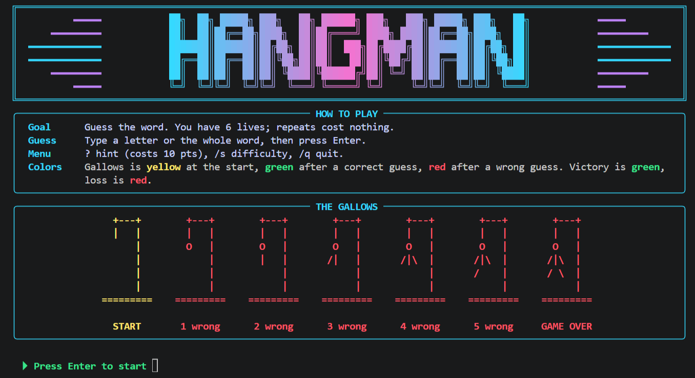
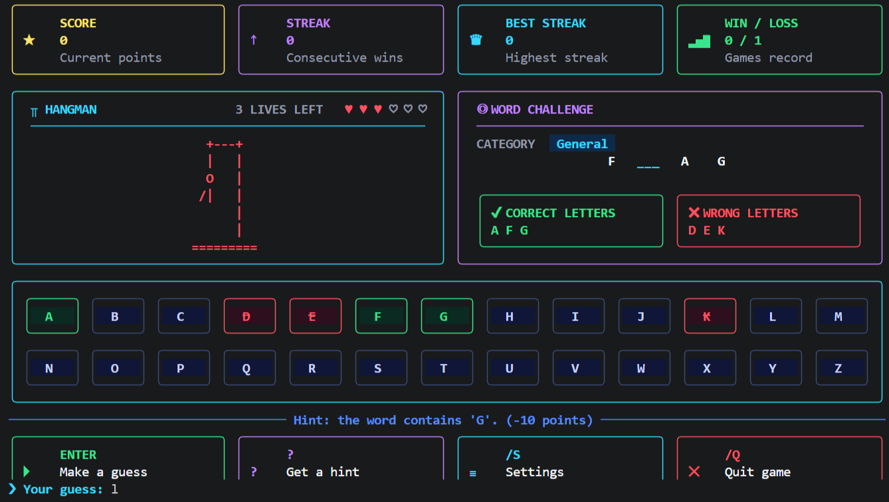
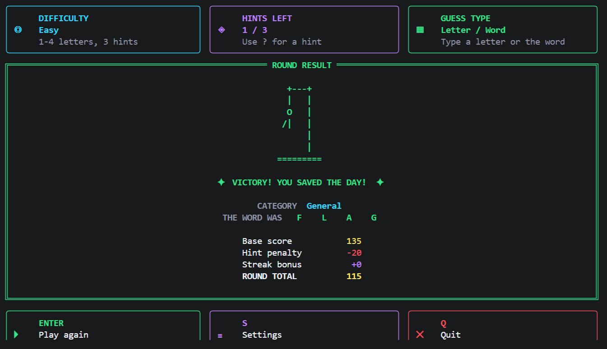
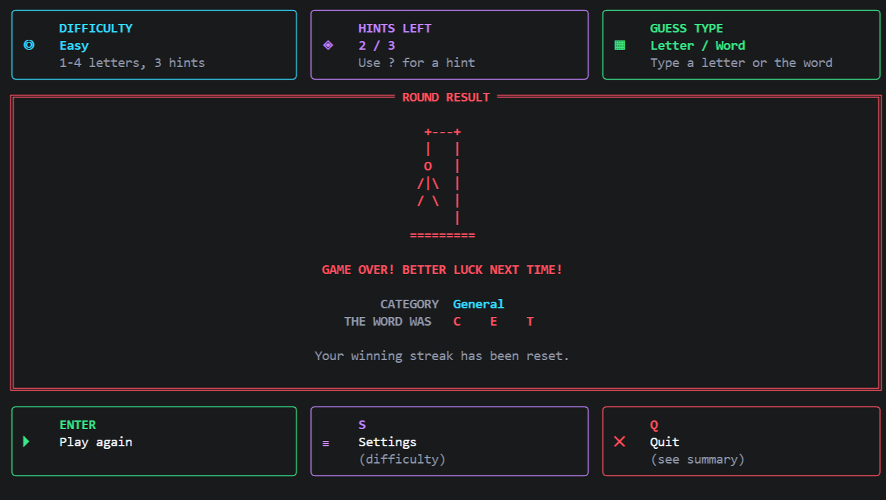

# Hangman Word Guessing Game(Console)

A colourful terminal Hangman game written in Python. Guess the hidden word one letter at a time (or all at once) before the gallows is complete. The game picks random words from a word list, shows each word's category, keeps score, rewards winning streaks, and offers three difficulty levels.

Built with the Python standard library only.



## Features

- **Random words with categories:** Words come from `words.txt`, and each round shows the word's category.
- **Six lives and seven gallows stages:** Every wrong guess draws one more part of the gallows in ASCII art.
- **Letter and whole-word guesses:** A wrong whole-word guess costs one life.
- **No penalty for repeats:** Guessing the same letter or word again is free.
- **Three difficulty levels:** Easy, Medium and Hard, with different word lengths, hints and score multipliers.
- **Limited hints:** Type `?` to reveal a letter (costs points).
- **Scoring and streaks:** Points for lives left, long words and winning streaks.
- **Session statistics:** Score, streak, best streak and win/loss record, plus a summary when you quit.
- **Colour feedback:** The gallows is yellow at the start, green after a correct guess, red after a wrong guess, green when you win and red when you lose.
- **Adaptive layout:** The screen adjusts to the terminal size, and colours switch off automatically when needed.
- **Input validation:** Rejects empty input, numbers, symbols and non-English letters without costing a life.
- **Logging:** Diagnostic messages are written to `hangman.log` using Python's `logging` module.
- **Tested:** A `pytest` suite covers the game rules, scoring, input handling and word-list loading.

## Screenshots

The screenshots below show a sample session using a one-word sample list in a 120-column terminal.

**Playing a round**



**Winning a round**



**Losing a round**



## Requirements

- Python 3.8 or newer
- A terminal that supports colours and Unicode box characters (Windows Terminal, macOS Terminal, iTerm2, GNOME Terminal, VS Code terminal)
- Best viewed at roughly 100 to 120 columns by 50 rows. On shorter terminals the game drops the biggest extras so the screen never scrolls. The minimum width is 60 columns.
- Optional: `pytest` to run the tests

## Installation

Clone the repository and navigate to the project directory:

```bash
git clone https://github.com/sadiaislam2023/Datheon_Python_Programming_Internship.git
cd Datheon_Python_Programming_Internship/Task-01-Hangman-Word-Guessing-Game
```

To run the tests, install `pytest`:

```bash
python -m pip install pytest
```

No other packages are needed to play the game.

## Usage

Start the game:

```bash
python hangman.py
```

### Command-line options

| Option | Meaning |
|---|---|
| `--words FILE` | Use a different word list (default: `words.txt` next to `hangman.py`) |
| `--no-color` | Turn off coloured output |
| `--force-color` | Use colours even if the output does not look like a terminal |

Colours are also switched off when the `NO_COLOR` environment variable is set. If your terminal shows unusual colours, set `HANGMAN_TRUECOLOR=0` to use the basic 16-colour mode.

## How to play

| You type | What happens |
|---|---|
| A single letter, then Enter | Guess that letter |
| A whole word, then Enter | Guess the full word |
| `?` | Use a hint (reveals one letter, costs 10 points) |
| `/s` | Change the difficulty (applies from the next round) |
| `/q` or `quit` | End the game and see the session summary |

You have **6 lives**. Each wrong letter or wrong whole-word guess costs one life. Guessing something you already tried costs nothing.

### Difficulty levels

| Level | Word length | Hints | Score multiplier |
|---|---|---:|---:|
| Easy | 1 to 4 letters | 3 | 1.0 |
| Medium (default) | 5 to 7 letters | 2 | 1.5 |
| Hard | 8 or more letters | 1 | 2.0 |

The ranges do not overlap, so a word belongs to exactly one level.

### Scoring

```text
base score   = (50 + 10 x word length + 15 x lives left) x difficulty multiplier
hint penalty = 10 points per hint used
streak bonus = 20 points x (consecutive wins - 1)
round total  = max(base - hint penalty, 10) + streak bonus
```

A lost round scores nothing and resets your streak.

## Word list

The game reads `words.txt` from the same folder as `hangman.py`. Each line is one word, and categories can be set in two ways:

```text
# Sports
tennis
football
cricket,Games
```

- A line starting with `#` followed by a category name sets the category for the words below.
- A word followed by a comma and a category assigns a category to that individual word.

### Word-list rules

- Only plain English letters (`a` to `z`) are accepted. Lines with numbers, spaces, accents or symbols are skipped.
- Words are case-insensitive, and duplicates are ignored.
- Words of any length can be used, from 1 letter up.
- `words.txt` is required. Every word in the game comes from this file, and nothing is hard-coded in the program.
- If the word list is missing or has no usable words, the game stops with a clear error message. This also applies to a file passed with `--words`.

### The included word list

The included `words.txt` contains **9,894 English words**. It has no categories by default, so every word shows the category **General**. You can replace it with your own list using the format above.

Every word in this list is playable:

- **Easy:** 2,184 words
- **Medium:** 4,307 words
- **Hard:** 3,403 words

The list is used as it is, so it also contains some abbreviations (for example, `pm` and `html`) and names.

## Project structure

```text
.
├── hangman.py          # The game
├── words.txt           # The word list the game uses (required)
├── test_hangman.py     # Pytest test suite
├── screenshots/
│   ├── intro.png
│   ├── gameplay.png
│   ├── victory.png
│   └── game-over.png
└── hangman.log         # Created automatically for diagnostic logging
```

## Logging

The game writes events to `hangman.log` next to the script, never to the game screen.

Example:

```text
2026-10-21 23:33:12,744 INFO Hangman started
2026-10-21 23:33:12,754 INFO Difficulty set to Medium
2026-10-21 23:33:12,754 INFO Round started (Medium, 7 letters)
2026-10-21 23:33:12,770 INFO Round quit by player
2026-10-21 23:33:12,773 INFO Session over: 0 wins, 0 losses, score 0
```

If the folder is read-only, logging is skipped and the game still runs.

## Running the tests

Install `pytest` if necessary:

```bash
python -m pip install pytest
```

Run the tests from the project directory:

```bash
python -m pytest
```

The test suite completed successfully with **127 tests passed**.

```text
127 passed in 2.60s
```

The tests do not need an internet connection, and they use their own small word lists, so they do not depend on `words.txt`.
