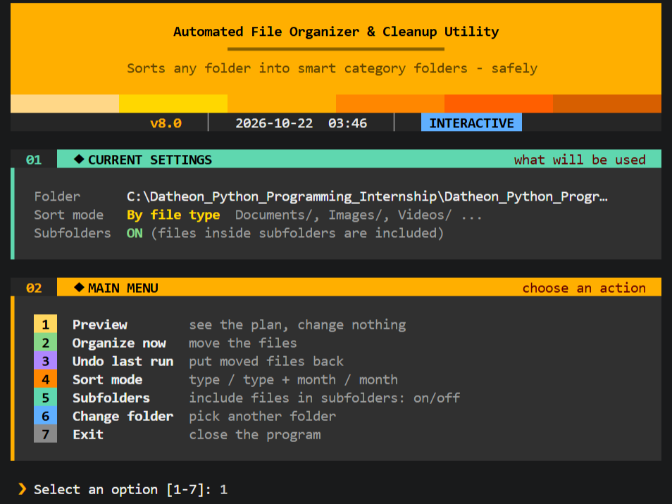
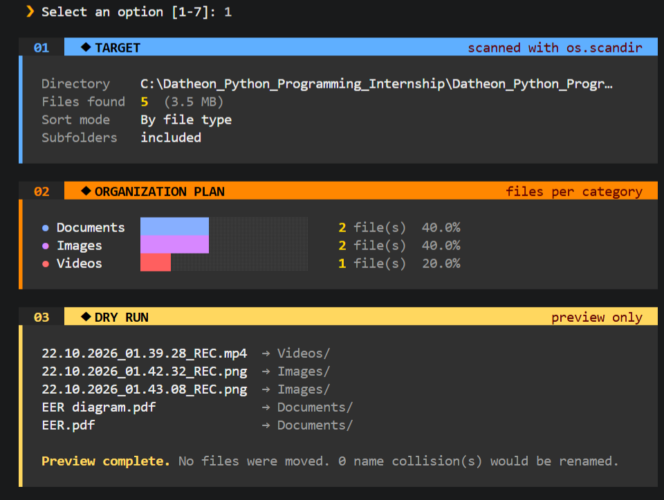
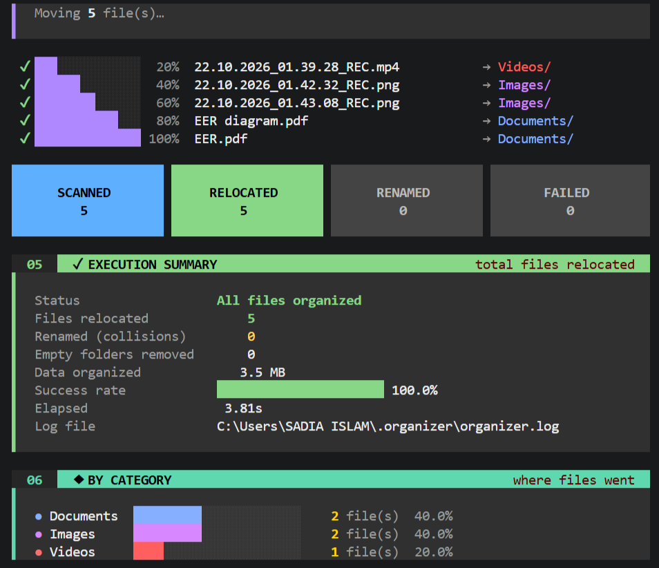
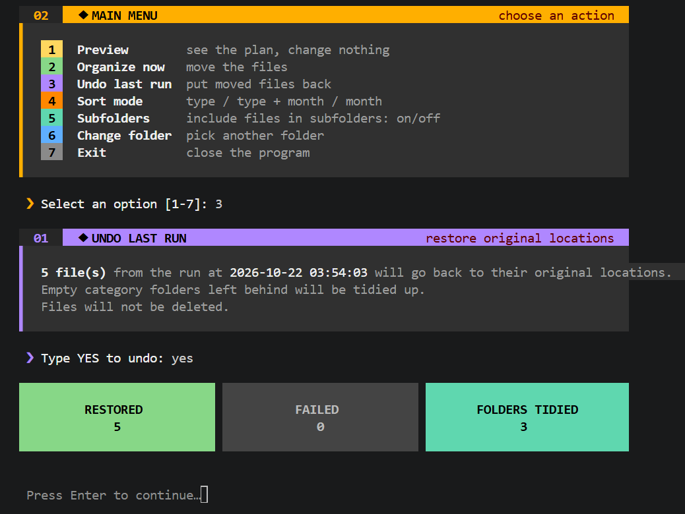

# Automated File Organizer & Cleanup Utility

A command-line tool that safely organizes a messy folder into tidy category folders. It never overwrites existing files, lets you preview every planned move before making changes, and can undo the last run.

**Built with Python's standard library. No runtime dependencies required.**

## Screenshots

### 1. Main Menu



### 2. Dry Run Preview



### 3. File Organization



### 4. Undo Operation



## Features

- **Three sorting modes:** By file type, by file type and month, or by month only.
- **Dry-run preview:** Shows planned destinations and filename conflicts without modifying files.
- **Collision-safe naming:** Never overwrites existing files. Conflicting names receive numbered suffixes, such as `report_1.pdf`.
- **Undo:** Restores files from the last run for a folder. Supports repeated undo attempts, partial failures, and interrupted runs.
- **Custom categories:** Supports an optional `categories.json` configuration file.
- **Recursive scanning:** Enabled by default, with empty-folder cleanup afterward.
- **Safety checks:** Refuses system folders, drive roots, the entire home folder, symlinked folders, and the script's own folder.
- **Folder lookup:** Accepts a folder name, such as `Projects`, instead of requiring a full path.
- **Terminal interface:** Provides colored output and progress bars, respects `NO_COLOR`, and maintains a log file.

## Requirements

- Python 3.9 or newer.
- `pytest` only if you want to run the test suite.

## Usage

### Interactive Menu

```powershell
python organizer.py
```

### Command-Line Examples

```powershell
python organizer.py Projects
python organizer.py "D:\MyFiles" --dry-run
python organizer.py "D:\MyFiles" --yes
python organizer.py "D:\MyFiles" --mode type_date
python organizer.py "D:\MyFiles" --no-recursive
python organizer.py "D:\MyFiles" --undo
python organizer.py "D:\MyFiles" --categories my_categories.json
```

The tool asks for confirmation before organizing unless `--yes` is specified. Use `--dry-run` to preview planned changes without moving files.

## Command-Line Options

| Option | Description |
|---|---|
| `folder` | Folder name or path. If omitted, the tool prompts for one. |
| `-n`, `--dry-run` | Preview planned changes without modifying files. |
| `-y`, `--yes` | Skip the confirmation prompt. |
| `-m`, `--mode` | Select `type` (default), `type_date`, or `date`. |
| `-r`, `--recursive` / `--no-recursive` | Include files in subfolders. Recursive scanning is enabled by default. |
| `-u`, `--undo` | Undo the last run for the specified folder. |
| `-c`, `--categories FILE` | Specify a JSON file that maps category names to file extensions. |
| `--search-limit SECONDS` | Maximum time allowed for folder-name searches. Default: 10 seconds. |

## Sorting Modes

| Mode | Result |
|---|---|
| `type` | `Documents/`, `Images/`, `Videos/`, and other category folders. |
| `type_date` | `Documents/2026-10/`, `Images/2026-09/`, and similar folders. |
| `date` | `2026-10/`, `2026-09/`, and similar folders based on file modification dates. |

Files with unrecognized extensions are placed in `Other/`.

## Custom Categories

By default, the tool uses built-in categories, including Documents, Images, Videos, Audio, Archives, and Code.

To customize the categories, create a `categories.json` file next to `organizer.py` or in `~/.organizer/`. Alternatively, specify a file using `--categories`.

Example:

```json
{
  "Documents": [".pdf", ".docx", ".txt"],
  "Ebooks": [".epub", ".mobi"]
}
```

### Category Rules

- A custom categories file **replaces** the built-in categories; it does not extend them. Include every category you want to use.
- An extension can belong to only one category.
- `Other` is reserved.
- Category names cannot resemble dates or contain any of these characters: `\ / : * ? " < > |`.
- If an explicitly specified categories file is invalid, the run stops with an error.
- If an automatically detected categories file is invalid, the tool displays a warning and falls back to the built-in categories.

## Safety and File Handling

- Every move is checked to ensure the destination remains inside the selected folder.
- Hidden files, symbolic links, incomplete downloads (such as `.crdownload`, `.part`, and `.tmp` files), and the organizer's own logs and history are skipped.
- In recursive mode, top-level folders recognized as categories or year-month folders, such as `Images` or `2026-10`, are treated as already organized and are not scanned.
- Each successful move is recorded in the undo history immediately, allowing interrupted operations to be reversed.
- Undo never deletes files. If the original location is occupied, the restored file receives a numbered filename.

> **Tip:** Recursive mode can also move files inside project directories, including source code and files within `node_modules`. Use `--dry-run` before organizing folders containing software projects, or use `--no-recursive` to restrict scanning to the selected folder's top level.

## Logs and History

Logs and undo history are stored in `~/.organizer/` by default.

- `organizer.log` — Records file operations and errors.
- `history.json` — Stores the last 20 runs for undo operations.

Set the `ORGANIZER_HOME` environment variable to use a different storage location.

## Exit Codes

| Code | Meaning |
|---|---|
| `0` | Success or nothing to organize. |
| `1` | Partial failure, cancellation, or unexpected error. |
| `2` | Invalid folder or invalid categories file. |
| `130` | Interrupted with Ctrl+C. |

## Running the Tests

Install `pytest` if it is not already installed:

```powershell
python -m pip install pytest
```

Run the test suite from the project directory:

```powershell
python -m pytest -v
```

The tests use temporary folders and a temporary `ORGANIZER_HOME` directory, so they do not modify your real files or existing undo history.

**Latest verified test results:** 40 passed, 2 skipped, 0 failed (42 tests collected). The skipped tests depend on platform-specific features or paths.

## Project Structure

```text
.
├── organizer.py        # Main application: file operations, undo, UI, and CLI
├── test_organizer.py   # Automated test suite
├── categories.json     # Optional custom categories
├── screenshots/        # Screenshots used in this README
└── TestFiles/          # Sample files for manual testing
```

## Known Limitations

- Undo history retains the last 20 runs across all folders combined.
- Dates in `type_date` and `date` modes are based on each file's modification time.
- Folder-name searches cover the home folder, mounted drives, and current directory, subject to the configured search time limit and search depth.
