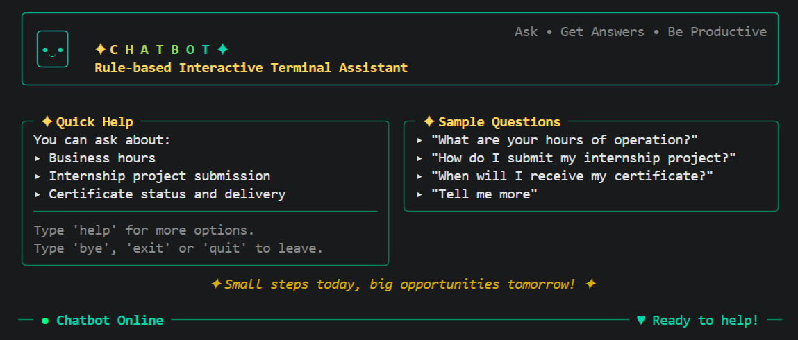
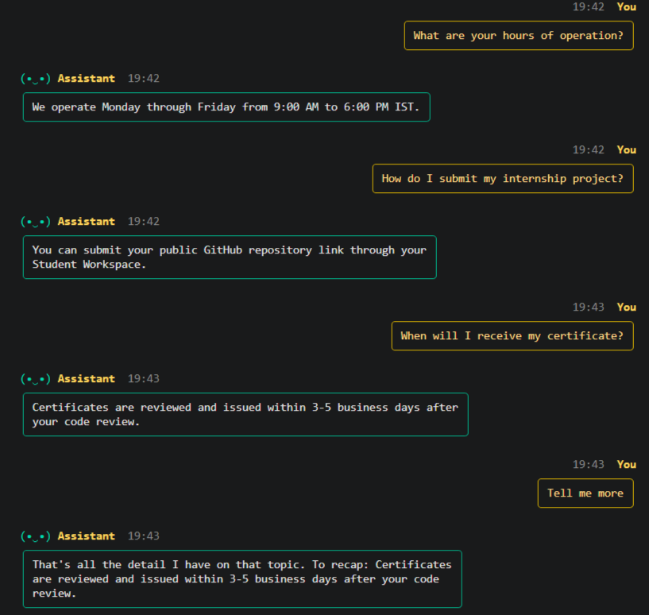
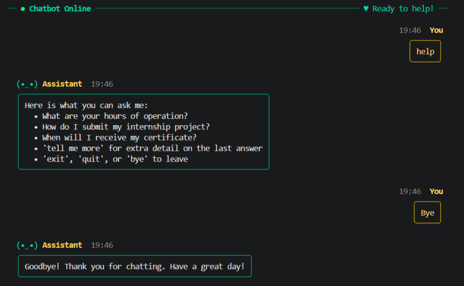

# Interactive Terminal Assistant (Chatbot)

**Task 4 - Rule-Based Interactive Terminal Assistant**

A rule-based customer-support chatbot that runs in the terminal. It answers
questions about business hours and product FAQs, understands greetings,
follow-up questions and rephrasings, falls back gracefully when it is unsure,
and exits cleanly on `bye`, `exit` or `quit`.

It uses **only the Python standard library**. There is nothing to install.

---

## Screenshots

### Dashboard on start-up

Banner, Quick Help and Sample Questions panels, and the status bar.



### A conversation

A greeting combined with a question, rephrased questions, and a follow-up
("tell me more").



### Low-confidence suggestion, fallback, help and exit

When the bot is not sure it suggests the closest question; when it finds
nothing it says so and points to `help`.



> The screenshots are rendered from the program's real output. Colors and
> fonts in your own terminal may look slightly different.

---

## Requirements covered

| Requirement | How it is done |
| --- | --- |
| Parse input for keywords and regular expressions | `normalize()`, `split_greeting()`, `term_present()` and the follow-up/small-talk patterns in `chatbot.py` use `re` |
| Business hours and product FAQs | Loaded from `faq.json` |
| Contextual responses | The bot remembers the last answered FAQ, so "tell me more" works |
| Normalise input | Lower-casing, whitespace collapsing, punctuation-tolerant matching |
| Conversation state | `State` enum: greeting, identifying, resolved, exited (`Session` class) |
| Graceful fallback when confidence is low | "Did you mean ...?" suggestion, then a plain fallback |
| Clean exit commands | `bye`, `exit`, `quit` (also `goodbye`, `stop`) |
| Bad or missing data file | Clear error message instead of a crash |

---

## Quick start

1. Install **Python 3.8 or newer**.
2. Put these three files in one folder:

   ```
   chatbot.py
   faq.json
   test_chatbot.py
   ```

3. Open a terminal in that folder and run:

   ```
   python chatbot.py
   ```

4. Type a question and press Enter. Type `bye` to leave.

For the best look, use a terminal that is at least 100 columns wide (maximize
the VS Code terminal panel or Windows Terminal).

---

## What you can ask

With the provided `faq.json`:

| You type | The bot answers |
| --- | --- |
| `What are your hours of operation?` | Business hours |
| `What time do you close?`, `Are you open on Saturday?`, `working hours` | Business hours |
| `How do I submit my internship project?` | Submission instructions |
| `How can I upload my project to GitHub?`, `where do I send my repo` | Submission instructions |
| `When will I receive my certificate?`, `When do certificates arrive?` | Certificate timing |
| `Hi, when will I receive my certificate?` | Greets, then answers |
| `tell me more` | Extra detail on the last answer (or a recap if there is none) |
| `help` | Lists everything the bot can answer |
| `thanks`, `who are you`, `how are you`, `ok` | Short small-talk replies |
| `bye`, `exit`, `quit`, `goodbye`, `stop` | Ends the chat |

### Commands

- **Exit:** `bye`, `exit`, `quit`, `goodbye`, `stop`
- **Help:** `help`, `commands`, `what can you do`
- **Follow-up:** `tell me more`, `more details`, `explain more`,
  `can you elaborate`, `what about that`, `more information`

---

## How it works

Each message goes through these steps in order:

1. **Normalise** - lower-case and collapse whitespace.
2. **Commands** - exit and help are handled first.
3. **Greeting** - a leading greeting (`hi`, `hello`, ...) is split off, so
   "Hi, what time do you close?" is still answered.
4. **Follow-up** - "tell me more" uses the last answered FAQ.
5. **FAQ match** (first rule that fits wins):
   1. exact question text;
   2. *strong terms* - the FAQ's `keywords` plus built-in synonyms
      (for example `hour` also matches `open`, `close`, `timing`, `schedule`);
      the FAQ with the most strong-term hits wins, weaker words break ties;
   3. word overlap - at least half of the question's content words must
      appear in the message, so one shared word such as "internship" is not
      enough.
6. **Small talk** - thanks, "who are you", "how are you", "ok".
7. **Low confidence** - if at least a quarter of a question's words match,
   the bot asks *"Did you mean ...?"* instead of guessing.
8. **Fallback** - otherwise it says it could not find an answer and points to
   `help`.

### Conversation states

```
GREETING --(greeting or first message)--> IDENTIFYING
IDENTIFYING --(FAQ matched)--> RESOLVED
RESOLVED --(follow-up)--> RESOLVED
RESOLVED --(new question matched)--> RESOLVED   (context updated)
any state --(bye / exit / quit)--> EXITED
```

An unmatched question never moves the chat to `RESOLVED`, and after a miss
the previous answer is still remembered for "tell me more".

---

## `faq.json` format

The bot loads its greetings and FAQs from `faq.json`. This is the provided
file; the bot works with exactly this structure:

```json
{
  "greetings": ["hello", "hi", "hey", "good morning", "good afternoon"],
  "faqs": [
    {
      "question": "What are your hours of operation?",
      "answer": "We operate Monday through Friday from 9:00 AM to 6:00 PM IST."
    },
    {
      "question": "How do I submit my internship project?",
      "answer": "You can submit your public GitHub repository link through your Student Workspace."
    },
    {
      "question": "When will I receive my certificate?",
      "answer": "Certificates are reviewed and issued within 3-5 business days after your code review."
    }
  ]
}
```

Rules:

- `greetings` - list of non-empty strings.
- `faqs` - list of objects; each needs a non-empty `question` and `answer`.
- `keywords` (optional) - list of extra words or phrases that identify the FAQ.
- `details` (optional) - extra text shown for "tell me more". Without it the
  bot recaps the answer.

Built-in synonyms exist only for the hours, submission and certificate topics.
For a new FAQ topic, add `keywords` so rephrasings are understood.

If `faq.json` is missing, is not valid JSON, or breaks these rules, the bot
prints a clear error and stops instead of crashing:

```
Error: Could not find 'faq.json'. Place faq.json in the same folder as chatbot.py.
Error: Invalid JSON in faq.json: ...
```

---

## Running the tests

```
python -m unittest -v
```

The suite has **66 tests** covering greeting handling, FAQ matching and
rephrasings, follow-ups, fallbacks and suggestions, exit commands, state
transitions, `faq.json` validation, logging, and the terminal layout (banner
fits every width, boxes line up, ASCII fallback).

---

## Logging

Diagnostics are written to `chatbot.log` next to `chatbot.py`: start-up,
loaded FAQ count, matched questions, low-confidence suggestions and unmatched
input. If the log file cannot be written, logging falls back to the console.

---

## Customising the look

Near the top of `chatbot.py`:

| Setting | Effect |
| --- | --- |
| `APP_NAME`, `SUBTITLE`, `TAGLINE` | Banner text |
| `TITLE_SPACING` | Spaces between the title letters (`0` for none) |
| `TITLE_GRADIENT` | Gold-to-teal colors of the title letters |
| `TITLE_FONT` | `"plain"` (default, ordinary bold letters), `"bold"` or `"fullwidth"` |

The interface adapts automatically:

- It uses colors only in a real terminal; set the environment variable
  `NO_COLOR` to turn colors off.
- If the terminal cannot show Unicode box characters, it switches to plain
  ASCII (`+`, `-`, `|`).
- Narrow terminals get stacked panels and a shorter banner.

---

## Troubleshooting

**`Import "chatbot" could not be resolved` in VS Code (Pylance)**
VS Code has opened a temporary copy of `test_chatbot.py` (the path contains
`AppData\Local\Temp`). Close it, open the project folder with
**File > Open Folder**, and open `test_chatbot.py` from there. The code itself
is fine.

**`AttributeError: module 'chatbot' has no attribute 'logger'`**
`chatbot.py` contains the test code. Save the chatbot program as `chatbot.py`
and the tests as `test_chatbot.py`.

**Box lines look misaligned**
Use a monospaced font such as Consolas or Cascadia Code and make the terminal
at least 100 columns wide.

**The title does not look bold**
Bold depends on the terminal. In VS Code, set `terminal.integrated.fontWeightBold`
to `900`.

---

## Project structure

```
Task-04-Interactive Terminal Assistant-Chatbot/
|-- chatbot.py          # the chatbot
|-- faq.json            # greetings and FAQs (data, not code)
|-- test_chatbot.py     # automated tests
|-- chatbot.log         # created when the bot runs
|-- README.md
`-- screenshots/
    |-- 01-dashboard.png
    |-- 02-conversation.png
    `-- 03-fallbacks-and-exit.png
```
